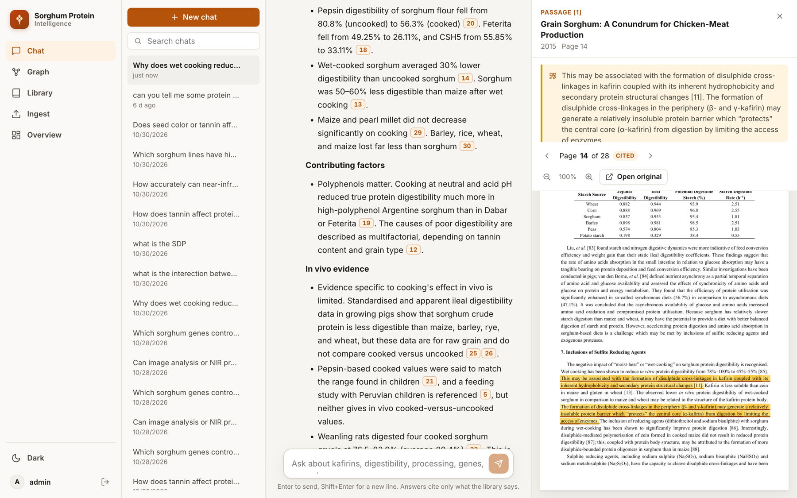
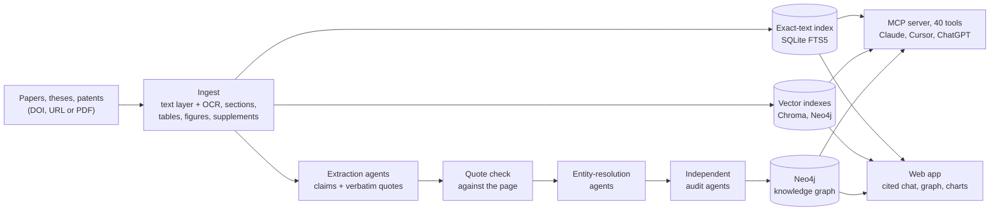
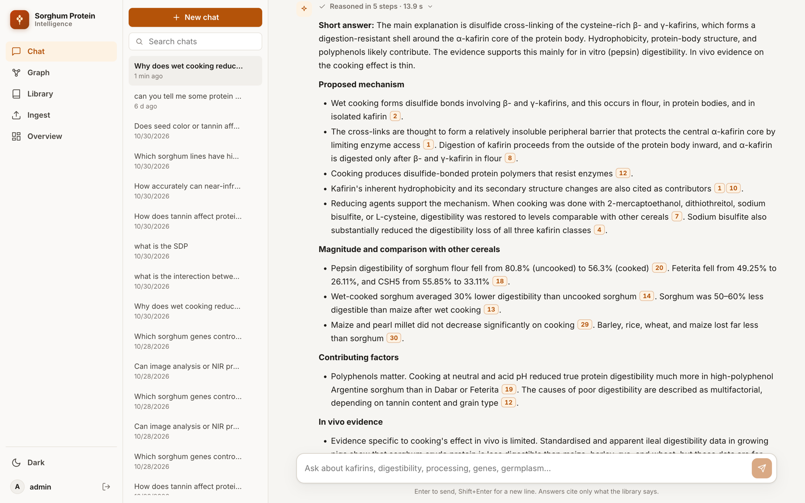
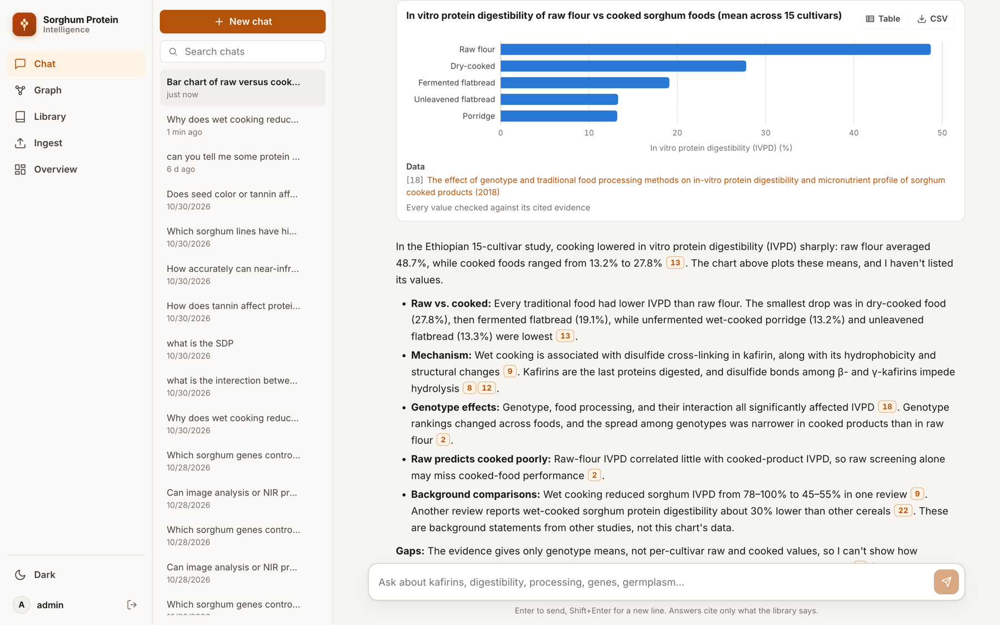
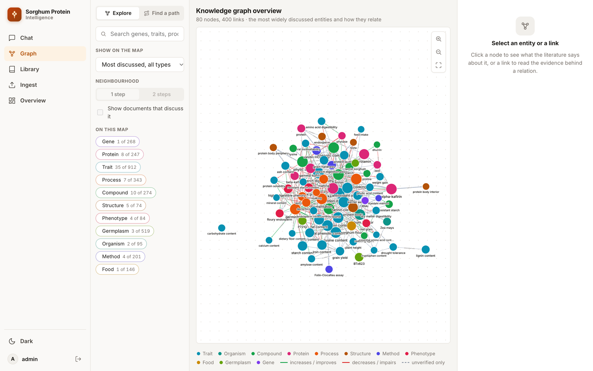
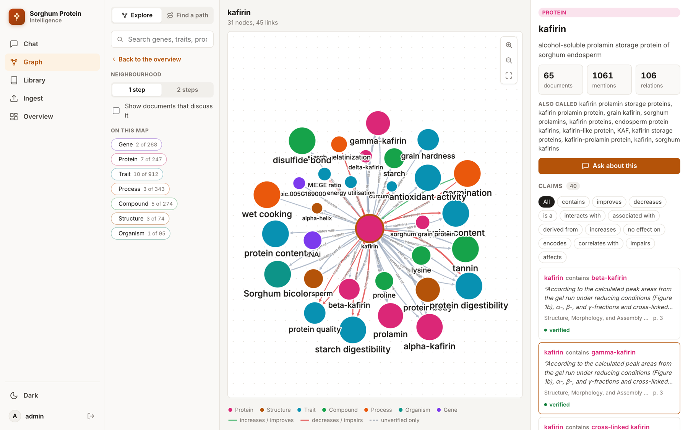
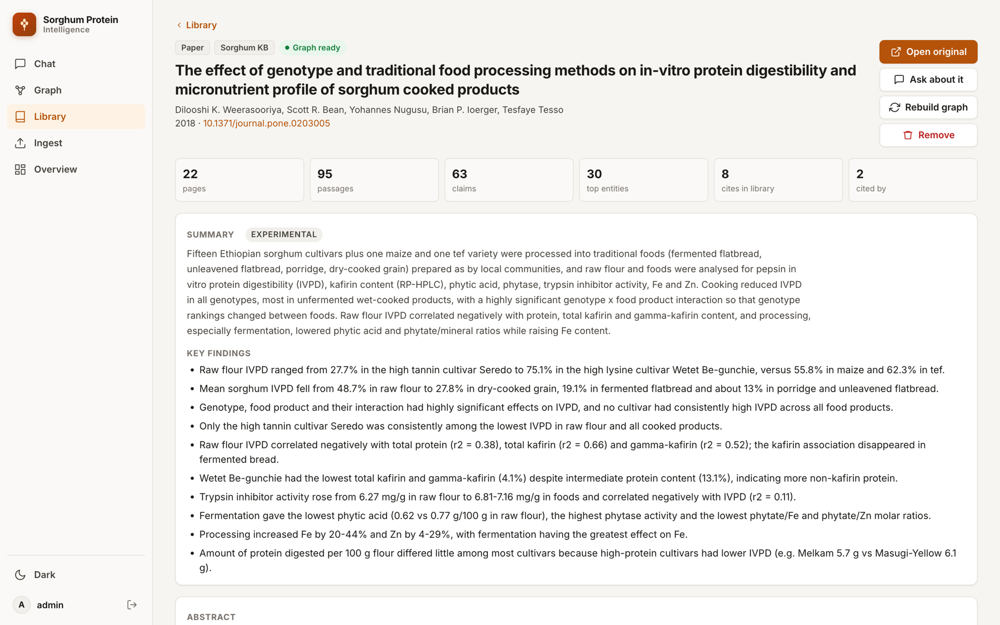
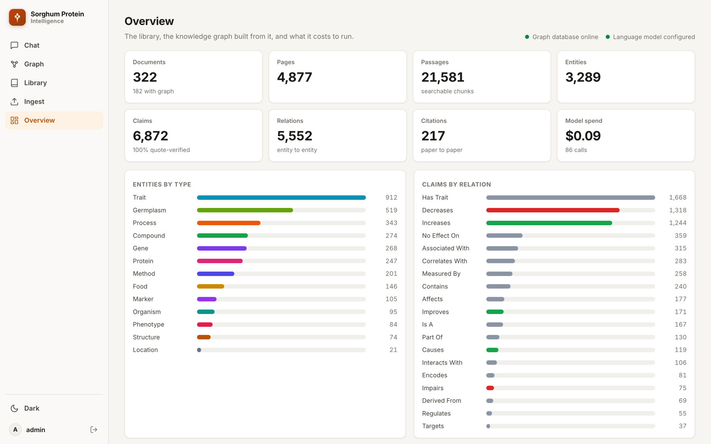

# Sorghum Protein KB

**An agent-built, evidence-linked knowledge base for sorghum grain protein research.**

Coding agents read every page of the literature and turn it into a knowledge graph. Every
claim in the graph points to a verbatim quote on a specific PDF page. Researchers then query
the graph and the full text from Claude, Cursor or ChatGPT through an MCP server with 40
tools, or through a web app where each answer cites its sources and opens the highlighted
page.

Built by the [Shakoor Lab](https://www.shakoorlab.com/) at the Donald Danforth Plant Science
Center, for work on sorghum protein digestibility and bioavailability for food security.



## Results from the October 2026 build

| | |
|---|---|
| Corpus | 182 full-text documents (papers, theses, patents), 2,706 pages including OCR of scanned pages, 142 supplementary data files, 986 catalogued works |
| Knowledge graph | 6,878 claims, each tied to a verbatim quote and page. In the deployed graph: 3,289 entities, 5,552 entity-to-entity relations, 217 paper-to-paper citations |
| Accuracy | An independent audit agent judged every claim: **96.1% correct before fixes** (6,492 of 6,753). Only 2 claims had the relation direction wrong. 11 unsupported claims were deleted, the rest corrected |
| Agents | 54 extraction agents, 4 entity-resolution agents, 8 audit agents, 2 re-extraction agents and a coordinating session (1,287 model requests) |
| Tokens | 186 million in total, mostly cached context: 4.1 million output, 13.0 million cache writes, 168.9 million cache reads. That is about **$182 at frontier-model API list prices**, or about $0.07 per page |
| Daily use | Chat answers use a fast-tier model at well under 1 cent per answer. Embeddings run locally, so search sends nothing out |

## How it works



1. **Ingest** (`kb/`): add a paper by DOI, URL or PDF. Every page is stored as text: the PDF text
   layer, plus OCR of scanned pages and of tables or figures saved as images. Sections, tables,
   figures, references and open-access supplements are extracted and indexed for exact
   identifier search (accessions such as `PI 533919`, gene IDs, numbers) and semantic search.
2. **Agent graph build** (`app/claude_graph/`): agents read whole documents and write claims
   (subject, relation, object, context, verbatim quote, page) under a controlled vocabulary of
   entity types and relations. A checker rejects any file whose quotes are not found on the
   cited page. Entity-resolution agents merge name variants across documents, and a separate
   audit agent judges every claim before import. See [docs/AGENT_WORKFLOW.md](docs/AGENT_WORKFLOW.md).
3. **Use**: researchers ask questions in their own AI assistant through the MCP server
   (`kb/scripts/sorghum_protein_mcp.py`), or in the web app (`app/`). In the web app, a
   LangGraph agent plans the search, retrieves passages and graph claims, answers, and then
   removes any citation it was not given.

## Screenshots

| | |
|---|---|
|  **Cited answer.** Every statement carries a numbered citation to a page. |  **Charts from evidence.** Values come from tables or cited text, and any value not found in its source is dropped. |
|  **Knowledge graph.** The most-discussed entities and how they relate. |  **One entity.** Kafirin's neighbourhood, with each claim's quote, page and verification status. |
|  **One paper.** Summary, key findings and the claims extracted from it. |  **Overview.** Corpus and graph counts and the running model cost. |

## Repository layout

| Path | What it is |
|---|---|
| [`kb/`](kb/) | Literature knowledge base: download and ingest, page text and OCR, structured extraction, exact-text, vector and graph indexes, supplements, and the MCP server (`scripts/sorghum_protein_mcp.py`) |
| [`kb/skills/`](kb/skills/) | A Claude skill that tells an assistant how to use the MCP tools and cite sources |
| [`app/`](app/) | Web app: FastAPI and LangGraph backend, React frontend, Neo4j, Docker Compose |
| [`app/claude_graph/`](app/claude_graph/) | Agent briefs for extraction, entity resolution and audit, merge and audit tools, the audit report, and three example extraction files |
| [`app/deploy/CLAUDE_EXTRACTION.md`](app/deploy/CLAUDE_EXTRACTION.md) | The full extraction guide each agent follows |
| [`docs/`](docs/) | Setup guide, agent workflow, data availability, screenshots |

## Quick start

```bash
git clone https://github.com/nurzaman7/sorghum-protein-kb.git
cd sorghum-protein-kb/kb
python3.12 -m venv .venv && .venv/bin/pip install -r requirements.txt
export KB_CONTACT_EMAIL=you@example.org        # polite-use contact for OpenAlex, Crossref, Unpaywall
.venv/bin/python scripts/ingest_paper.py 10.1371/journal.pone.0203005   # add an open-access paper
.venv/bin/python scripts/query_kb.py "How does fermentation affect sorghum protein digestibility?"
```

Then connect the MCP server to Claude, Cursor or ChatGPT, or run the web app. Both are covered
step by step in **[docs/GUIDE.md](docs/GUIDE.md)**.

## Data availability

This repository holds code, agent instructions, the bibliographic catalog, the audit report and
example extractions. It does not redistribute paper PDFs or full text, which you rebuild from
open-access sources with the scripts. It also leaves out the lab's unpublished measurements,
which the lab-data MCP tools read only when they are present locally. Details are in
[docs/DATA.md](docs/DATA.md).

## Citation

If you use this work, please cite it as described in [CITATION.cff](CITATION.cff).

## License

Code is released under the MIT License ([LICENSE](LICENSE)). Extracted claims quote short
passages from the cited publications, which remain under their publishers' licenses.
