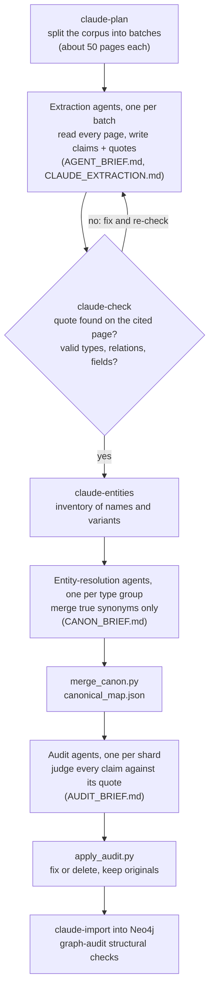

# Agent workflow: building the knowledge graph

The knowledge graph is built by coding agents (Claude Code), not by a fixed extraction script.
Each agent reads whole documents, writes structured claims with verbatim evidence, and has to
pass a mechanical check before its file is accepted. Separate agents then resolve entity names
and audit every claim. This page describes the stages, the quality gates and what the October
2026 build cost.

## Stages



| Stage | Agents in the October 2026 build | Instructions | Output |
|---|---|---|---|
| Extraction | 54, plus 2 re-extraction runs | [AGENT_BRIEF.md](../app/claude_graph/AGENT_BRIEF.md), [CLAUDE_EXTRACTION.md](../app/deploy/CLAUDE_EXTRACTION.md) | One JSON file per document: summary, study type, key findings, entities, claims |
| Entity resolution | 4 (chemistry, genetics, processes, traits) | [CANON_BRIEF.md](../app/claude_graph/CANON_BRIEF.md) | [canon/*.json](../app/claude_graph/canon/), 238 name variants merged |
| Audit | 8, one per shard | [AUDIT_BRIEF.md](../app/claude_graph/AUDIT_BRIEF.md) | Verdicts per claim, [audit/report.json](../app/claude_graph/audit/report.json) |
| Coordination | 1 session | this page | Batches, checks, merges, import |

## What a claim looks like

Every claim is a typed triple with its context, a short statement, whether it is the paper's
own finding or background, and a verbatim quote from a numbered page:

```json
{
  "page": 2,
  "subject": "wet cooking",
  "subject_type": "PROCESS",
  "relation": "DECREASES",
  "object": "protein digestibility",
  "object_type": "TRAIT",
  "statement": "Wet cooking decreases sorghum protein digestibility.",
  "context": "sorghum",
  "value": "",
  "kind": "background",
  "evidence": "The best-known example of this for sorghum is the decrease in protein digestibility when sorghum is wet-cooked",
  "confidence": 0.85
}
```

The vocabulary is fixed: 13 entity types (gene, protein, trait, process, compound, structure,
phenotype, germplasm, organism, method, marker, location, food) and 19 directed relations
(increases, decreases, improves, impairs, no effect on, affects, causes, correlates with,
associated with, encodes, regulates, interacts with, part of, contains, is a, has trait,
derived from, targets, measured by). Negative results are kept as `NO_EFFECT_ON` claims.

Three complete extraction files from open-access (CC BY) papers are in
[app/claude_graph/examples/](../app/claude_graph/examples/).

## Quality gates

1. **Quote check (mechanical).** `claude-check` searches for each quote in the text of the cited
   page. A file with any quote that is not found, or with invalid fields, is rejected, and the
   agent fixes it and re-runs the check until it passes. In the deployed graph, 100% of claims
   are quote-verified.
2. **Entity resolution (agents).** The rule is to merge only true synonyms and never fold a
   narrower concept into a broader one (gamma-kafirin is not kafirin, cooked protein
   digestibility is not protein digestibility).
3. **Independent audit (agents).** A second agent, which did not write the claim, judges whether
   the quote supports the claim as encoded: direction and sign, relation type, entities, value,
   and finding versus background.
4. **Structural audit.** `graph-audit` reports unverified claims, documents without a graph,
   entities without claims, names typed inconsistently, and unusual relation and type
   combinations to read again.

## Audit result

| | Claims |
|---|---:|
| Judged | 6,753 |
| Correct as extracted | 6,492 (**96.1%**) |
| Finding versus background label wrong | 194 |
| Wrong entity | 34 |
| Wrong value | 12 |
| Wrong relation type | 8 |
| Unsupported by the quote (deleted) | 11 |
| Direction or sign wrong | 2 |

Fixes were applied by [apply_audit.py](../app/claude_graph/tools/apply_audit.py), which keeps the
original files. Most issues were labelling (finding versus background), not wrong science.

## Cost

All numbers come from the per-request usage records of the run (1,287 model requests).

| Quantity | Value |
|---|---|
| Documents and pages | 182 documents, 2,706 pages, 11.0 million characters |
| Claims | 6,878 (2.54 per page) |
| Tokens | 186.0 million: 168.9 million cache reads, 13.0 million cache writes, 4.1 million output (including 1.5 million reasoning) |
| Cost at frontier-model API list prices | about $182, or $0.07 per page. The run itself used a subscription plan, not API credit |
| Measured per page | 1,535 input tokens and 1,269 output tokens for extraction, plus 624 input and 63 output for the audit |

Most tokens are cache reads: agents re-read their own growing context on every step, and cached
tokens cost a small fraction of fresh ones.

## Running it on new documents

New uploads in the web app are searchable at once. Their graph comes from running the same
stages for those documents only:

```bash
.venv/bin/python -m sorghum_intel claude-plan claude_graph --only <doc_id> ...
# one extraction agent per batch, then claude-check
.venv/bin/python -m sorghum_intel claude-import claude_graph --only <doc_id> ...
```

To extract automatically through an API model instead, set `SI_EXTRACT_MODE=openrouter`. That
path makes one call per page with the same vocabulary and the same quote check.
